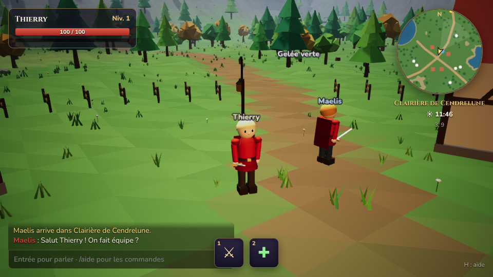
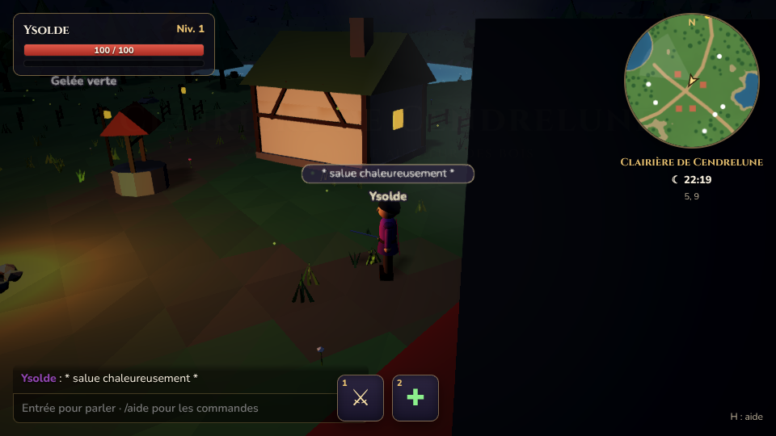
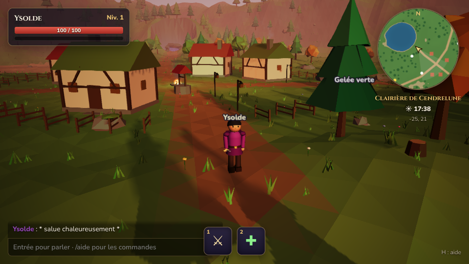
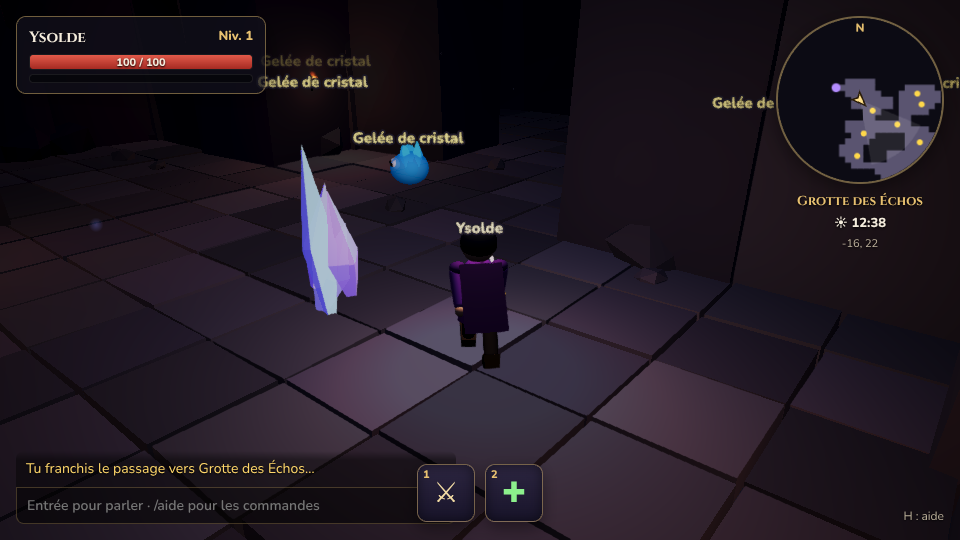

# Cendrelune

Un petit MMORPG PvE à l'ancienne, dans la lignée d'EverQuest, jouable dans le navigateur.
On y joue surtout en groupe, mais le jeu en solo reste possible. Le monde est découpé en zones
(extérieur, village, donjon) reliées par des passages.

> Prototype 0.1 : une zone de test jouable, à plusieurs, avec combat, expérience et donjon.

| | |
| --- | --- |
|  |  |
|  |  |

*Captures faites en qualité basse, avec un rendu logiciel sans carte graphique.*

## Lancer le jeu sur Mac

1. Il faut **Node.js 22 ou plus récent** (`node -v` dans le Terminal). Sinon, installe la version LTS depuis [nodejs.org](https://nodejs.org).
2. Double-clique sur **`Lancer Cendrelune.command`**.
   - La première fois, il installe les dépendances (environ une minute).
   - Il prépare le jeu, démarre le serveur et ouvre `http://localhost:2567` dans ton navigateur.
3. Pour jouer à plusieurs : ouvre un **deuxième onglet** à la même adresse, avec un autre nom.
4. Pour arrêter le serveur : ferme la fenêtre du Terminal.

Si ton Mac rame, ajoute `?qualite=basse` à l'adresse : `http://localhost:2567/?qualite=basse`.

Au premier double-clic, macOS peut demander une confirmation. Dans ce cas, fais un clic droit sur
le fichier, choisis **Ouvrir**, puis confirme.

## Commandes

| Touche | Action |
| --- | --- |
| ZQSD / WASD / flèches | Se déplacer (AZERTY et QWERTY reconnus automatiquement) |
| Maj | Marcher au lieu de courir |
| Espace | Sauter |
| Clic gauche ou droit + glisser | Tourner la caméra |
| Molette | Zoomer |
| Clic sur un monstre ou un joueur | Le cibler (double-clic sur un monstre : attaquer) |
| Tab | Cible suivante |
| 1 | Attaque automatique |
| 2 | Lumière apaisante (soigne ta cible amicale, ou toi-même) |
| Échap | Annuler la cible |
| Entrée | Discuter |
| H | Afficher / masquer l'aide |

Commandes de chat : `/salut`, `/assis`, `/qui`, `/loc`, `/ambiance`, `/aide`.

### Ambiances

La Clairière peut prendre 5 ambiances. Pour en essayer une (chez toi seul), tape dans le chat :
`/ambiance printemps`, `/ambiance automne`, `/ambiance hiver`, `/ambiance marais` ou `/ambiance cendres`.
`/ambiance zone` revient à l'ambiance prévue. On peut aussi ouvrir directement `http://localhost:2567/?ambiance=hiver`.

## Contenu du prototype

- **Clairière de Cendrelune** (extérieur) : un village avec ses maisons à colombages, son feu de camp, son puits et ses lanternes. Autour : un lac, des forêts, des montagnes et des chemins de terre.
- **Grotte des Échos** (donjon) : des couloirs éclairés à la torche, des cristaux lumineux, des gelées de cristal et un boss, le **Gardien des Échos**, prévu pour un groupe.
- **Changement de zone** par les passages runiques. Le personnage (niveau, XP, PV) suit d'une zone à l'autre.
- **Cycle jour/nuit** synchronisé entre tous les joueurs : soleil, lune, étoiles, lucioles et fenêtres éclairées la nuit.
- **Combat** contre des monstres pilotés par le serveur : attaque automatique, coups critiques, dégâts flottants, mort et réapparition.
- **Jeu en groupe** : l'XP d'un monstre est partagée entre tous ceux qui l'ont combattu, avec un bonus de groupe. Le soin peut viser un autre joueur.
- **Difficulté « à l'ancienne »** : la couleur du nom d'un monstre indique sa difficulté, du gris au rouge, avec un message quand on le cible.
- **Interface** : cadre du joueur et de la cible, mini-carte, horloge, chat avec bulles au-dessus des têtes, barre d'actions.

Tous les décors, personnages et monstres sont **générés en code** : il n'y a aucun fichier 3D externe.

## Architecture

| Rôle | Choix | Licence |
| --- | --- | --- |
| Langage | TypeScript, partout | Apache 2.0 |
| Moteur 3D (client) | [Babylon.js](https://www.babylonjs.com/) 9 | Apache 2.0 |
| Serveur de jeu | Node.js + [Colyseus](https://colyseus.io/) 0.18 | MIT |
| Outil de build | [Vite](https://vite.dev/) 8 | MIT |
| Base de données | En mémoire pour l'instant ; PostgreSQL prévu | – |

- Le **serveur fait autorité** : il simule les monstres, le combat, l'XP et l'heure du jour, et il valide les déplacements (vitesse, zones praticables).
- **Une zone = un type de room Colyseus.** Changer de zone revient à quitter une room et à en rejoindre une autre, grâce à un « billet de voyage » délivré par le serveur. Si une instance de zone est pleine (80 joueurs), une autre est créée.
- Le **terrain et le décor sont déterministes** (bruit avec une graine). Le client et le serveur calculent exactement le même monde à partir du même code (`src/shared`).

```
src/
  app.config.ts         configuration du serveur (zones = rooms)
  characters.ts         personnages en mémoire + billets de voyage entre zones
  rooms/ZoneRoom.ts     logique d'une zone : joueurs, monstres, combat, XP
  rooms/schema/         état synchronisé (joueurs, monstres, heure)
  shared/               code commun client/serveur : règles, zones, terrain, bruit
  client/
    main.ts             écran titre
    game.ts             boucle de jeu, réseau, contrôles, caméra
    world/              génération des zones (extérieur, donjon, ciel, décor)
    entities/           personnage humanoïde et monstres animés
    ui/                 interface, mini-carte, noms et dégâts flottants
```

## Développement

```bash
npm install        # première fois
npm start          # mode développement avec rechargement à chaud (http://localhost:5173)
npm run build      # build de production (dist/client + dist/server)
npm run serve      # lance le build de production (http://localhost:2567)
npm run typecheck  # vérification TypeScript
```

Le journal des décisions et des étapes est dans [`docs/JOURNAL.md`](docs/JOURNAL.md).
